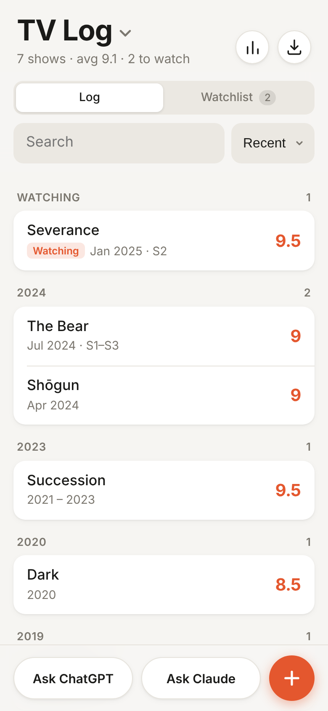
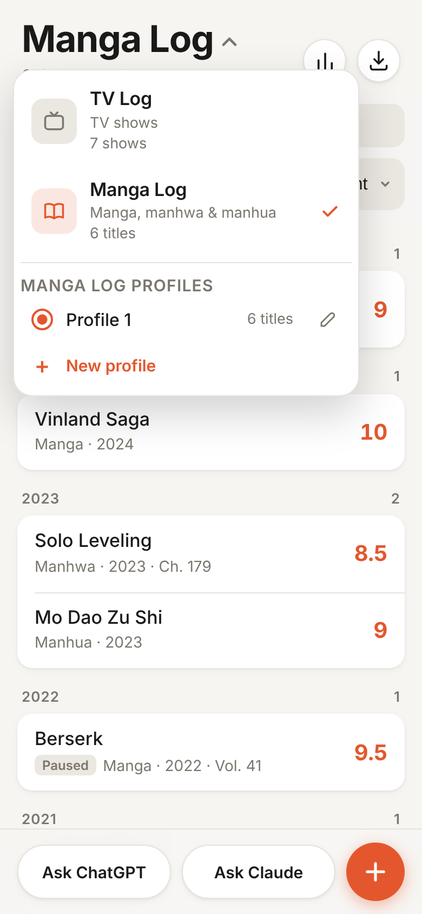
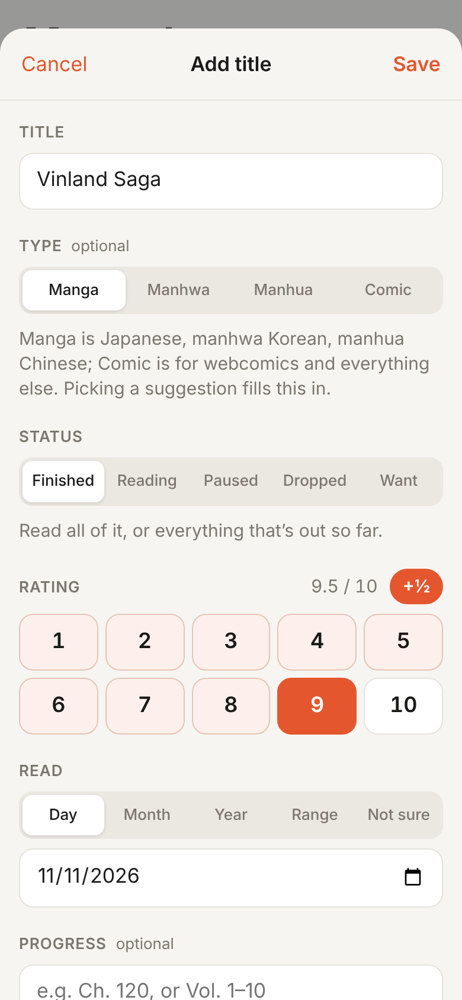

# TV Log

**A private, offline-first log for the TV shows you watch and the manga, manhwa and manhua you read.**

TV Log is a mobile-first web app built to live on an iPhone home screen. It has no accounts and no server: everything is stored on your device, and nothing leaves it unless you export it. It's plain HTML, CSS and JavaScript with no build step, deployed to GitHub Pages.

**[Open the app →](https://egosashimi.github.io/tv-tracker/)**

<p align="center">
  
  &nbsp;
  
  &nbsp;
  
</p>

## Features

### Logging
- Each entry has a **name**, a **rating out of 10** (half points allowed), and **when you watched or read it**.
- **Flexible dates:** an exact day, a month, a year, a range such as 2019–2021, or "not sure".
- **Status:**
  - **Finished**
  - **Watching / Reading**
  - **Paused:** stopped for now, planning to return.
  - **Dropped:** tried it and didn't like it.
  - **Want to watch / Want to read**
- **Seasons or chapters** and a **note** per entry, both optional.
- A **watchlist / reading list** tab, **search**, and sorting by recent, rating or name.
- **Stats:** rating spread, entries per year, a status breakdown, and top-rated titles.

### Two logs, multiple profiles
- **TV Log and Manga Log.** Switch between them from the title menu. Both use the same interface; each keeps its own data.
- **Manga types.** The Manga Log tags each title as **manga**, **manhwa**, **manhua** or **comic** (webcomics and other comics).
- **Profiles.** Each log can have several profiles, e.g. *Manhwa* and *Manga*. Each profile has its own list, settings and backups.

### Recommendations
- **Ask ChatGPT / Ask Claude** opens the assistant with your full history and a prompt asking for recommendations. You can optionally say what you're in the mood for and choose how many picks you want.
- **Dropped titles count as dislikes.** The prompt says so, and keeps paused titles separate from dropped ones.
- **Picks go straight to your list.** Paste the reply back in and the suggested titles can be added to your watchlist or reading list in one tap.

### Covers and title suggestions
- **TV Log:** posters and suggestions come from [TVmaze](https://www.tvmaze.com/api).
- **Manga Log:** queries [AniList](https://anilist.co), [Kitsu](https://kitsu.app) and [MyAnimeList](https://myanimelist.net) (via [Jikan](https://jikan.moe)) in parallel and merges the results. No single database covers every manhwa, manhua and webcomic.
- **Fan translations still match.** Titles are matched against every database's alternate titles. For example, *Return of the Mount Hua Sect* finds *Return of the Blossoming Blade*.
- **Only the title you look up is sent.** Lookups can be turned off, and an optional content-rating filter is available.

### Import and export
- **Import:** JSON, CSV (including IMDb ratings exports and episode-level exports such as TV Time), MyAnimeList XML exports, text exported to Notes, or one title per line.
- **Export:** **Send to Notes** through the iOS share sheet, **Copy JSON**, or **Save backup file**. A reminder appears when a backup is overdue.

### App experience
- **Installs to the home screen** and works offline, including covers that have already loaded.
- **Follows light and dark mode.**
- **Undo** after deleting an entry.

## Getting started

### Install on iPhone
1. Open the [app](https://egosashimi.github.io/tv-tracker/) in **Safari**.
2. Tap **Share → Add to Home Screen**.
3. Launch it from the home screen. It runs full screen, like a native app.

> **Note:** a home screen app keeps its own storage, separate from Safari's. Import your data from inside the installed app, and keep a backup: removing the app from the home screen also removes its data.

### Run locally
There's no build step. Serve the folder with any static file server:

```sh
python3 -m http.server 8000
# then open http://localhost:8000
```

### Deploy your own copy
1. Fork the repository.
2. In **Settings → Pages**, set **Source** to **GitHub Actions**.
3. Push to `main`. The workflow in `.github/workflows/pages.yml` publishes the site.

## Import format

The importer is deliberately forgiving. In JSON, only `name` is required:

```json
[
  { "name": "Severance",  "status": "finished", "rating": 9,   "date": "2024-03-15" },
  { "name": "The Bear",   "status": "watching", "rating": 8.5, "date": "2022/2024", "seasons": "S1–S3" },
  { "name": "Twin Peaks", "status": "paused",   "rating": 8,   "date": "2020" },
  { "name": "Riverdale",  "status": "dropped",  "rating": 3,   "date": "2018", "note": "Not for me" },
  { "name": "Shōgun",     "status": "want" }
]
```

In the Manga Log, entries can also include `"type"` (`manga`, `manhwa`, `manhua` or `comic`) and `"progress"` (e.g. `"Ch. 120"`).

| Field  | Accepted values |
| ------ | --------------- |
| name   | `name`, `title`, `show`, `series`, and similar keys, or a plain array of strings |
| status | `finished` / `completed` / `watched` · `watching` / `reading` / `in progress` · `paused` / `on hold` · `dropped` / `abandoned` · `want` / `plan to watch` / `plan to read` |
| rating | Numbers out of 10 (`8`, `7.5`), `"8/10"`, `"4/5"` (rescaled), `"85%"`, star ratings |
| date   | `2024-03-15`, `2024-03`, `2024`, `March 2024`, `3/15/2024`; ranges such as `2019-2021`, `2019 to 2021`, `2019/2021`; `{ "from": 2019, "to": 2021 }`; `2010s`, `summer 2023`, `late 2020`, `~2015`; `null` when unknown |

The importer also accepts `{ "shows": [...] }` wrappers, Markdown code fences, typographic quotes and trailing commas, so text copied from Notes or a chatbot reply imports cleanly. Entries already in the log are updated rather than duplicated.

## Privacy

- **Stored on your device.** All data lives in the browser's local storage. There are no accounts, analytics or tracking.
- **What goes out:** network requests are only made to look up titles (TVmaze, AniList, Kitsu and Jikan), and only the searched title is sent. Turning off covers in settings disables these lookups.
- **Recommendations:** your list is only shared when you tap **Ask ChatGPT** or **Ask Claude**. That opens the service in a new tab with your list in a prefilled prompt; the service may send it straight away.

## Project structure

| Path | Purpose |
| ---- | ------- |
| `index.html` | Markup, including the add/edit, recommendation, stats, profile and import/export sheets |
| `styles.css` | Mobile-first styles with light and dark themes |
| `app.js` | Application logic: per-log configuration (`MODES`), profiles, storage, parsing and import/export, prompts, external lookups and rendering |
| `sw.js` | Service worker: network-first for the app shell, cache-first for cover images |
| `manifest.webmanifest`, `icons/` | Web app manifest and home screen icons |
| `docs/screenshots/` | Images used in this README |
| `.github/workflows/pages.yml` | GitHub Pages deployment |

## Acknowledgements

Title data and cover images are provided by [TVmaze](https://www.tvmaze.com), [AniList](https://anilist.co), [Kitsu](https://kitsu.app) and [MyAnimeList](https://myanimelist.net) through [Jikan](https://jikan.moe). Please respect their terms of use and rate limits.
